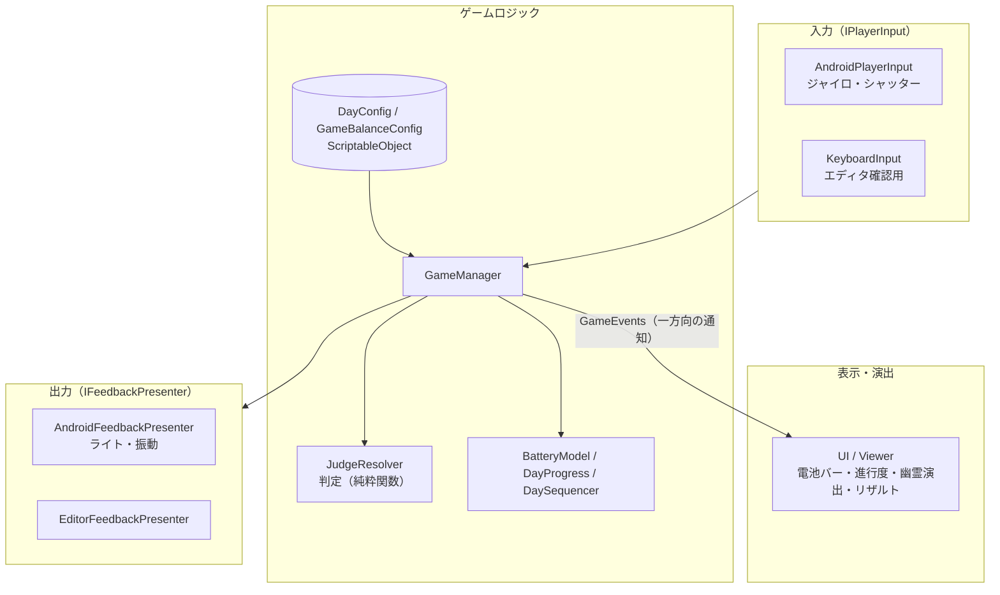

# そろそろ帰ろう

スマホを持って振り返り、背後に現れる「何か」をフラッシュで撮って追い払いながら、家まで歩いて帰るウォーキングホラーゲームです。

`Unity 6000.3` / `URP` / `Android` / `約1週間・3人で開発`

CyberAgent「Proto Sprint League」（2026年8月）のチーム制作物です。

<!-- スクリーンショット・GIF は docs/images/ に置いてここに貼る -->

---

## どんなゲーム？

夜道を歩いて家に帰るゲームです。背後から聞こえる音を頼りに、振り返るかどうかを決めます。

- **前を向いている間だけ進む** — 一定時間歩くと家に着き、その日はクリア
- **背後で音が鳴る** — 「異常音」なら振り返って撮影すると撃退できます。「環境音」なら放っておくのが正解です
- **スマホそのものがコントローラー** — 端末を後ろに向けると振り返り（ジャイロ）。振り返っている間は端末のライトが点き、シャッターボタンで撮影します
- **電池が減っていく** — ライトを点けている間と撮影するたびに電池を使います。電池は1日ごとに回復します
- **全6日** — Day0（チュートリアル）のあと Day1〜5。日が進むほど歩く距離が延び、異常音が増え、判断できる時間が短くなります

### 判定

| 鳴った音 | 振り返って撮影 | 何もしない |
|---|---|---|
| 異常音 | **撃退**（スコア加算） | ゲームオーバー |
| 環境音 | **空振り**（電池を使い、少しのあいだ動けない） | 正解 |

異常音で振り返らなかった・撮らなかった・電池が切れていた場合はゲームオーバーです。

### 見どころ

- 端末のジャイロとライトを使い、体ごと振り返る操作
- 音だけを頼りに、異常音と環境音を聞き分ける緊張感
- 電池が限られているので、「とりあえず全部撮る」が通用しない

---

## 設計

約1週間・3人の短期開発なので、作り込んだ設計よりも**チームが迷わず進められる軽さ**を優先しました。



1. **入力と出力をインターフェースで切り替えられるようにした**
   `IPlayerInput` / `IFeedbackPresenter` で実機とエディタの実装を差し替えます。ジャイロやライトの対応が仕上がるまではキーボード入力でゲームを作り進め、仕上がった時点で Android 用モジュールに付け替えました。
2. **ロジックから UI への通知は一方向**
   UI は `GameEvents`（C# の static event）を購読するだけで、`GameManager` を直接参照しません。UI からロジックへ伝える通知は2つ（リザルトを閉じた・シャッターを切った）だけに絞っています。
3. **難易度はデータで調整する**
   日ごとの難易度は `DayConfig`、電池の消費量や待ち時間は `GameBalanceConfig` にまとめ、コードを触らずに調整できます。判定ロジック `JudgeResolver` は状態を持たない純粋関数です。

外部ライブラリは使わず、Unity と C# の標準機能だけで実装しています（メンバー全員が読めるコードにするため）。

### フォルダ構成

```
Assets/_sorosoro-kaerou/Scripts/
├── Core/              判定・電池・イベント通知など、ゲームの中核
├── GameLoop/          GameManager、日の進行、チュートリアル
├── Data/              判定結果・リザルトなどのデータ型
├── ScriptableObject/  DayConfig / GameBalanceConfig の定義
├── Android/           ジャイロ・ライト・カメラ権限など実機向け機能
├── Player/            歩行・カメラ制御
├── UI/                ボタン・ダイアログ
├── Viewer/            演出・画面遷移・リザルト表示
├── Manager/           フェードなどの共通マネージャー
└── Dev/               デバッグ表示・キーボード入力（開発用）
```

---

## 動かし方

1. Unity **6000.3.22f1** でプロジェクトを開く
2. **エディタで試す**: `Title` シーンから再生。キーボードで操作できます

   | キー | 操作 |
   |---|---|
   | ← / → を押している間 | 振り返る |
   | Z | 撮影 |

3. **実機で遊ぶ**: Android 向けにビルド。ジャイロ搭載の端末が必要です。ライトを使うため、起動時にカメラの権限を許可してください

---

## 開発メンバー

| 名前 | 主な担当 |
|---|---|
| 野口楓馬 | 各シーン（タイトル・チュートリアル・本編・リザルト）と UI |
| 山内陽 | Android 実機対応（ジャイロ・ライト・入力） |
| 髙橋荘悟 | コアロジックの設計、チームの開発環境づくり |
